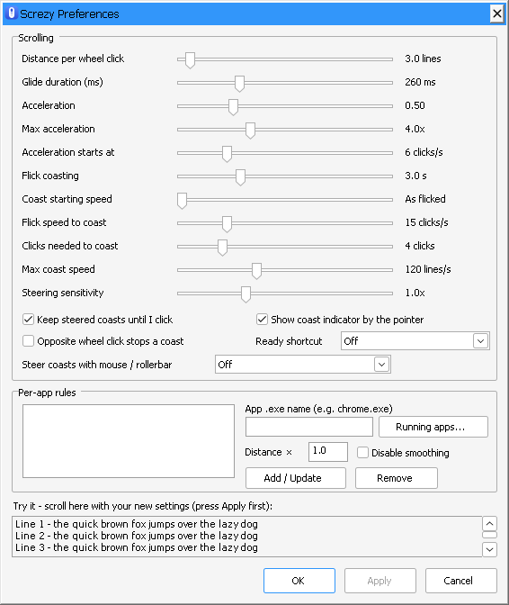

  

<h1 align="center">Screzy</h1>

<b>Scroll easy. Flick to coast. Steer with mouse or rollerbar.</b> 
Easy, smooth mouse-wheel scrolling for Windows. 
Free and open source (MIT) · Windows 10 and 11 · Tiny, no installer needed

---

A normal mouse wheel scrolls in jumps. Screzy turns each click into a smooth glide in every app: browsers, Office, PDF readers, code editors. Flick the wheel fast and the page keeps coasting, like a phone or a free-spinning wheel. A click stops it.

## Features

- **Smooth glides.** Each wheel click eases in and out instead of jumping. Steps are timed to your monitor's refresh rate (60, 120, 144 Hz…), so the motion is even.
- **Acceleration.** Spin faster and each click goes further. Slow, careful scrolling stays precise.
- **Flick coasting.** Flick the wheel and let go, and the page keeps gliding at that speed, then gently runs down. A left, middle or right click where you were scrolling stops it, and only stops it: that click isn't passed on, so it can't open a link or press a button by accident. If you've moved the pointer away first, say to a tab or a button, the click stops the coast and still goes through. A coast also stops when the pointer moves onto another window or you switch apps.
- **Steer a coast.** While it coasts, a wheel click in the same direction speeds it up and one the other way slows it down. Once you steer, the coast holds that speed, which makes a hands-free reading scroll.
- **Autoscroll (optional).** Set a flick to start autoscroll instead of a coast, like middle-click autoscroll in a browser: move the pointer or a RollerMouse bar down or up to scroll, further to go faster. A small badge marks the start point.
- **Per-app rules.** Give an app its own scroll distance, or turn smoothing off for it (handy for games). Pick from a list of running apps.
- **Stays out of the way.** Touchpads and high-resolution wheels, Ctrl + wheel zoom, sideways scrolling and windows running as administrator are left alone.
- **Lightweight.** A single small `.exe` that uses no CPU while you're not scrolling. No network access, no telemetry ([privacy statement](PRIVACY.md)).

## Install

**Microsoft Store:** [get Screzy from the Store](https://apps.microsoft.com/detail/9PFTRF7TP5PS). It's the easiest option. Updates are automatic and there are no security warnings.

**Download:** grab `Screzy.exe` from the [latest release](../../releases/latest) and run it. Nothing to install; it lives in the system tray. Because the download isn't code-signed, Windows may show a SmartScreen warning on first run. Choose **More info → Run anyway**, or right-click the file → **Properties → Unblock** first.

## Using it

- Screzy runs in the **system tray**. Double-click the icon, or launch the app again, to open **Preferences**. Right-click it for the menu.
- The icon turns **grey** when smoothing is switched off.
- **Start with Windows** is in the tray menu, with a check mark when it's on. In the Store version it switches Windows' own startup setting on and off. If you've turned Screzy off on Windows' Startup apps page, only you can turn it back on there, so the item opens that page instead.

### Settings

Preferences has three sections. The defaults are tuned to feel good out of the box, so you only need it to fine-tune.

**Scrolling**

| Setting | What it does | Default |
|---|---|---|
| Distance per wheel click | How far one click scrolls, shown in lines | 1× your Windows setting |
| Glide duration | How long each glide lasts, 50–1200 ms. Longer feels floatier, shorter feels snappier | 800 ms |
| Acceleration | How much faster scrolling gets as you spin quicker | 1.2 |
| Max acceleration | Upper limit for acceleration | 6× |

**Coasting**

| Setting | What it does | Default |
|---|---|---|
| Coast length | How long a flick keeps gliding: Off, 0.5–10 s, or *Until stopped* | 7 s |
| Coast speed | 0.25–2× the flick's speed, so you can make coasts calmer or livelier and still keep the feel of the flick | 1× the flick |
| Clicks needed to coast | How many fast clicks in a row a flick needs. Raise it if coasts start when you don't want them | 10 clicks |
| Flick speed to coast | How fast you must spin to trigger coasting | 8 clicks/s |
| Max coast speed | Upper limit for coasting speed, or *No limit* | 60 lines/s |

**Autoscroll**

| Setting | What it does | Default |
|---|---|---|
| A flick starts autoscroll instead of a coast | A flick stops the page and starts autoscroll at the pointer (see below) | Off |
| Autoscroll starts at | The speed autoscroll sets off at, in the flick's direction, from *Standstill* up to 10 lines/s | 10 lines/s |
| Autoscroll sensitivity | How far you move the pointer to reach full speed. Higher means a shorter distance | 1.5× |

The two autoscroll sliders are greyed out while autoscroll is off.

Not in Preferences, but available in `screzy.ini`:

- `acceleration_starts_at=5`: the wheel speed, in clicks per second, where acceleration begins.
- `opposite_click_stops_coast=1`: one opposite wheel click stops a coast instead of slowing it down a step.
- `show_coast_indicator=1`: show the indicator badge beside the pointer for every coast, not just in autoscroll.

### Steering a coast

Flick the wheel to start a coast, then adjust it with the wheel while it's moving:

- **Same direction:** each click speeds it up a step.
- **Other direction:** each click slows it down a step, and a slow coast stops.
- **Any steering holds the speed.** The coast stops running down, so you can read at a steady pace. A click stops it.
- **Calmer coasts:** set *Coast speed* to 0.25–0.5× for a reading pace that still follows how hard you flicked. For a coast that keeps going until you click, also set *Coast length* to *Until stopped*. For full control of the pace while you read, use autoscroll.

### Autoscroll

Tick *A flick starts autoscroll instead of a coast*, then flick the wheel over a page:

- The page stops, a small badge marks the start point at the pointer, and autoscroll sets off in the flick's direction at *Autoscroll starts at* (10 lines/s unless you change it, or *Standstill*). Late clicks from the flick itself are ignored.
- Move the pointer below the badge to scroll down, above it to scroll up, and further away to go faster. Your whole speed range is spread over the distance: about 1 line/s just outside the start, rising to your *Max coast speed* about 280 px away. *Autoscroll sensitivity* makes that distance shorter or longer.
- Move back onto the badge to stand still. Autoscroll keeps going until you click.
- The wheel works too: each click moves the speed one step (1, 2, 3, 4, 5, 6, 8, 10, 12, 15, 20 … 100 lines/s). Clicks the other way step back down, through a standstill and into reverse, so you can autoscroll with the wheel alone. Wheel and pointer add together, and the wheel never ends autoscroll.
- With a RollerMouse, rolling the bar moves the pointer, so it steers autoscroll too.

### Per-app rules

Pick an app with **Running apps…** (or type its `.exe` name), then:

- **Distance ×** multiplies *Distance per wheel click* for that app only. Use 2.0 to scroll twice as far per click (handy in some PDF readers or Excel), or 0.5 for half. Coasts started in that app scale with it.
- **Disable smoothing** leaves that app's scrolling completely untouched, which is useful for games.

Press **Add / Update**, then **Apply**.

### Tip: set Windows to 1 line per click

Apps multiply every scroll step by Windows' own **lines per click** setting. The smaller that setting, the finer each glide step, and the smoother scrolling looks. If it's set high (some mouse software sets 10–20 lines), each tiny step becomes a jump of several pixels and scrolling looks jagged. For the smoothest result:

1. **Settings → Bluetooth & devices → Mouse → Lines to scroll at a time:** set it to **1**. Use **3** if you prefer how some apps feel with it.
2. Raise **Distance per wheel click** in Screzy until the distance feels right.

## Good to know

- **Apps that scroll by whole lines** (some older programs, and plain Windows text boxes) can't show sub-line steps, so they look steppier than browsers. Add a per-app rule if one misbehaves.
- **Other mouse software:** if your mouse software has its own smooth scrolling or a scroll-speed setting, turn those off or down to avoid doubling up.
- **Don't run it alongside other smooth-scrolling tools.**

## How it works

Screzy installs a low-level mouse hook on its own highest-priority thread, so the pointer never waits on the rest of the app. Ordinary pointer movement leaves the hook immediately. Each real wheel click (a multiple of 120 units) is swallowed and added to a target distance. An animation thread then moves toward that target with a critically damped spring, sending small wheel steps with `SendInput`, one per display frame, locked to the monitor's refresh rate. A minimum step size keeps the end of each glide even. Acceleration comes from the smoothed rate of wheel clicks. A flick hands its current speed to a coast that decays exponentially, unless the user steers it with wheel clicks, which then set and hold the coast's speed. In autoscroll, the pointer's distance from the start point sets the speed instead. Everything is plain C and Win32 with no dependencies; see [`src/screzy.c`](src/screzy.c).

## Building

You need MinGW-w64.

- **Linux / macOS / WSL:** `sudo apt install mingw-w64` (or `brew install mingw-w64`), then `./build.sh`
- **Windows:** install [w64devkit](https://github.com/skeeto/w64devkit) or MSYS2's `mingw-w64-x86_64-gcc`, then run `build.cmd`

The result is `build/Screzy.exe`, a single static executable. The Store (MSIX) package is built with `store/pack.ps1`; see [`store/README.md`](store/README.md). The screzy.com website lives in [`website/`](website/), and the release steps are in [PUBLISHING.md](PUBLISHING.md).

## Privacy

Screzy collects nothing and makes no network connections. Settings stay in one local file. Full details are in [PRIVACY.md](PRIVACY.md).

## Name

Screzy was called *GlideScroll* during development. When you first start Screzy, it carries over GlideScroll's settings and start-with-Windows entry, and closes a running GlideScroll.

Screzy is not affiliated with Contour Design. RollerMouse is a trademark of Contour Design, Inc.

## License

[MIT](LICENSE) © 2026 Eranno AS
